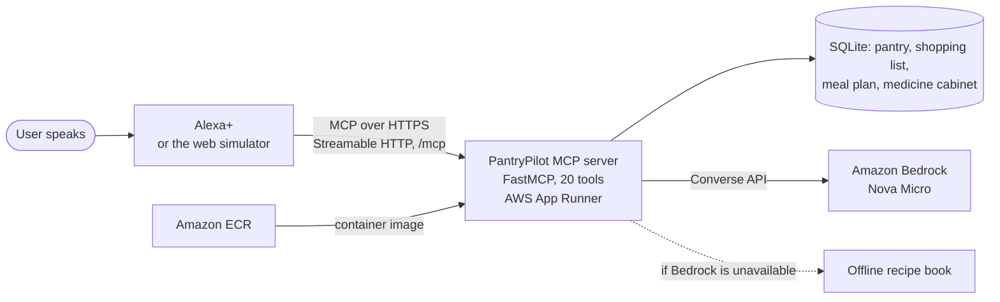

# PantryPilot: an Alexa+ MCP server that fights food waste

Track: **Alexa+** (self-hosted MCP server, Streamable HTTP) | Mini challenge: **AWS Builder** (Amazon Bedrock)

> "Alexa, good morning."  
> "Add six eggs that expire in ten days."  
> "What's expiring soon?"  
> "What can I cook tonight?"  
> "Plan my dinners for the week."  
> "Which medicines expire this month?"

PantryPilot gives Alexa+ a persistent household pantry plus recipes that use the soonest-expiring food first — reducing food waste one voice command at a time. Recipes come from Amazon Bedrock, with a built-in recipe book (`offline_recipes.py`) when Bedrock is unavailable.

> **Note:** our AWS account is currently blocked from calling Bedrock models ([FR-09](FRICTION_LOG.md)), so the live demo uses the offline recipe book. `GET /health` shows the last Bedrock result.

---

## How it works



Alexa+ reads each tool's description to decide which one to call, sends the call over MCP, and speaks the short reply. Every reply is written to be heard: one to four sentences, no lists or markdown.

---


## Tools (all voice-first: short, speakable, no markdown)

| Tool | What Alexa says |
|---|---|
| `add_item` | "Add 6 eggs that expire in 10 days" |
| `use_item` | "Use 2 eggs" |
| `list_pantry` | "What's in my pantry?" |
| `expiring_soon` | "What's expiring this week?" |
| `suggest_recipe` | "What can I cook tonight?" → Bedrock, offline recipe book fallback (preference-aware) |
| `add_to_shopping_list` | "Add milk to my shopping list" |
| `get_shopping_list` | "Read my shopping list" |
| `weekly_meal_plan` | "Plan my dinners for the week" → Bedrock, offline recipe book fallback (preference-aware) |
| `waste_report` | "What did I use this week?" |
| `set_preferences` | "I don't eat coriander" / "I'm vegetarian" |
| `get_preferences_tool` | "What are my dietary preferences?" |
| `schedule_meal` | "Plan pasta carbonara for Tuesday" |
| `get_meal_schedule` | "What's on my meal plan this week?" |
| `add_medicine` | "Add a bottle of paracetamol 500 mg that expires March 2027" |
| `list_medicines` | "What's in my medicine cabinet?" |
| `medicines_expiring` | "Which medicines expire this month?" |
| `find_medicine` | "Do we have any allergy tablets?" |
| `use_medicine` | "I used the last of the cough syrup" |
| `remove_expired_medicines` | "Remove expired medicines" |
| `daily_briefing` | "Good morning" / "What do I need to know today?" |

### Medicine cabinet: inventory only, never medical advice

Families keep half-forgotten medicines for years. PantryPilot tracks them like food: expiry dates as printed on the pack ("03/2027", "March 2027"), oldest batch used first, expired stock flagged and never "used", and safe disposal guidance (pharmacy take-back). Questions about dosing, safety, or which medicine to take get a fixed reply pointing to the label, a pharmacist, or a doctor; the same guard keeps medical questions out of the Bedrock recipe prompt.

---

## Quick start (local)

```bash
# 1. Clone and set up
git clone https://github.com/abhisuman2001/pantrypilot-alexa-mcp.git
cd pantrypilot-alexa-mcp

python -m venv .venv
.venv\Scripts\activate          # Windows
# source .venv/bin/activate     # macOS / Linux

pip install -r requirements.txt

# 2. Configure AWS credentials (needed for Bedrock)
cp .env.example .env            # then fill in your values
# AWS_ACCESS_KEY_ID=...
# AWS_SECRET_ACCESS_KEY=...
# AWS_REGION=us-east-1
# BEDROCK_MODEL_ID=amazon.nova-micro-v1:0   (enable in Bedrock console first)
# MCP_API_KEY=                              # optional: leave blank for local dev

# 3. Run
.venv\Scripts\python server.py    # http://localhost:8000/mcp
```

The server starts with **CORS enabled** so the web simulator works out of the box.

---

## Web Simulator (demo asset)

The server hosts the simulator at `/`. Start the server, then open:

```
http://localhost:8000/                                  # local
https://kykh233phz.us-east-1.awsapprunner.com/          # live, no setup needed
```

The page calls `/mcp` on the same server it was loaded from. Serving it over http(s) (not `file://`) is also what lets the browser microphone work.

Features:
- Alexa-style voice chat UI (dark mode, animated ring)
- One-click quick actions for the pantry, shopping list, and recipe tools
- Forms for Add Item / Use Item / Add to Shopping List
- 🎤 Web Speech API voice input (Chrome/Edge)
- Natural language parsing: "add 6 eggs expire 10 days", "what can I cook?", etc.
- Settings panel: configure server URL + API key

---

## Use it from any MCP client (the way Alexa+ calls it)

The live server is a standard MCP endpoint, so any MCP client can discover and call its tools.

**MCP Inspector** (no install):

```bash
npx -y @modelcontextprotocol/inspector
# Transport: Streamable HTTP, URL: https://kykh233phz.us-east-1.awsapprunner.com/mcp
# Then: List Tools, and call daily_briefing or add_medicine
```

**Claude Code**, so an AI agent picks the tools from their descriptions, as Alexa+ does:

```bash
claude mcp add --transport http pantrypilot https://kykh233phz.us-east-1.awsapprunner.com/mcp
# then ask: "add six eggs that expire in ten days, then tell me what to cook tonight"
```

**Raw JSON-RPC** with curl:

```bash
curl -s https://kykh233phz.us-east-1.awsapprunner.com/mcp \
  -H "Content-Type: application/json" -H "Accept: application/json, text/event-stream" \
  -d '{"jsonrpc":"2.0","id":1,"method":"tools/call","params":{"name":"daily_briefing","arguments":{}}}'
```

Local development works the same with `http://localhost:8000/mcp`.

---

## Run tests

```bash
.venv\Scripts\pytest -v
# 160 passed
```

Smoke-test a deployed server end to end (it also reports whether Bedrock answered or the offline recipes were used):

```bash
python scripts/live_smoke.py                                   # live App Runner URL
python scripts/live_smoke.py http://localhost:8000             # or any other base URL
```

---

## Environment variables

| Variable | Default | Description |
|---|---|---|
| `PORT` | `8000` | HTTP port |
| `PANTRY_DB` | `pantry.db` | SQLite file path |
| `AWS_REGION` | `us-east-1` | Bedrock region |
| `BEDROCK_MODEL_ID` | `amazon.nova-micro-v1:0` | Model (enable in console) |
| `DEFAULT_OWNER` | `default` | Pantry owner when no header present |
| `MCP_API_KEY` | _(empty)_ | Bearer token; empty = auth disabled |

## Privacy & Terms

Served inline by the App Runner deployment:
- Privacy Policy: `https://kykh233phz.us-east-1.awsapprunner.com/privacy`
- Terms of Use: `https://kykh233phz.us-east-1.awsapprunner.com/terms`
- Health check: `https://kykh233phz.us-east-1.awsapprunner.com/health`

---

## Deploy (Docker → AWS App Runner)

```bash
# One-command deploy (builds, pushes to ECR, creates App Runner service):
Set-ExecutionPolicy -Scope Process -ExecutionPolicy Bypass
.\deploy.ps1
```

**Live deployment:**
- Service URL: `https://kykh233phz.us-east-1.awsapprunner.com`
- MCP endpoint: `https://kykh233phz.us-east-1.awsapprunner.com/mcp`
- ECR image: `448049796441.dkr.ecr.us-east-1.amazonaws.com/pantrypilot:latest`

---

## Alexa+ Registration

```
TODO(verify): registration steps pending — see track Resources page.
The MCP endpoint to register is: https://<your-domain>/mcp
```

---

## Submission checklist

- [x] All 20 tools callable via MCP Inspector and web simulator
- [x] `pytest` passes (160 tests)
- [x] Bedrock called in code in `suggest_recipe` and `weekly_meal_plan` (preference-aware, offline recipe book fallback)
- [ ] Bedrock answering live — blocked at the AWS account level, see [FR-09](FRICTION_LOG.md)
- [x] Bearer-token auth (`MCP_API_KEY`), input validation, no stack traces exposed
- [x] Deployed over HTTPS — `https://kykh233phz.us-east-1.awsapprunner.com/mcp`
- [x] Privacy policy and Terms of Use served at `/privacy` and `/terms`
- [x] `set_preferences`, `schedule_meal`, `get_meal_schedule` added (Step 9)
- [x] Medicine cabinet: 6 tools, inventory only, medical-advice guard
- [x] `daily_briefing` for an Alexa+ morning routine
- [ ] Redeploy to App Runner with new tools
- [ ] Demo video recorded (≤ 3 min, voice demo first) — **record and link here**
- [x] Devpost description written — see [SUBMISSION.md](SUBMISSION.md)
- [x] Product feedback for every tool/API/SDK used — see [SUBMISSION.md](SUBMISSION.md#product-feedback-required)
- [x] Friction log completed (+10% bonus) — see [FRICTION_LOG.md](FRICTION_LOG.md) (9 items, severity + workaround + suggestion each)

> **Demo note:** the live deployment runs with `MCP_API_KEY` unset so judges can call it without a key. The pantry is shared demo data and resets on every redeploy.

